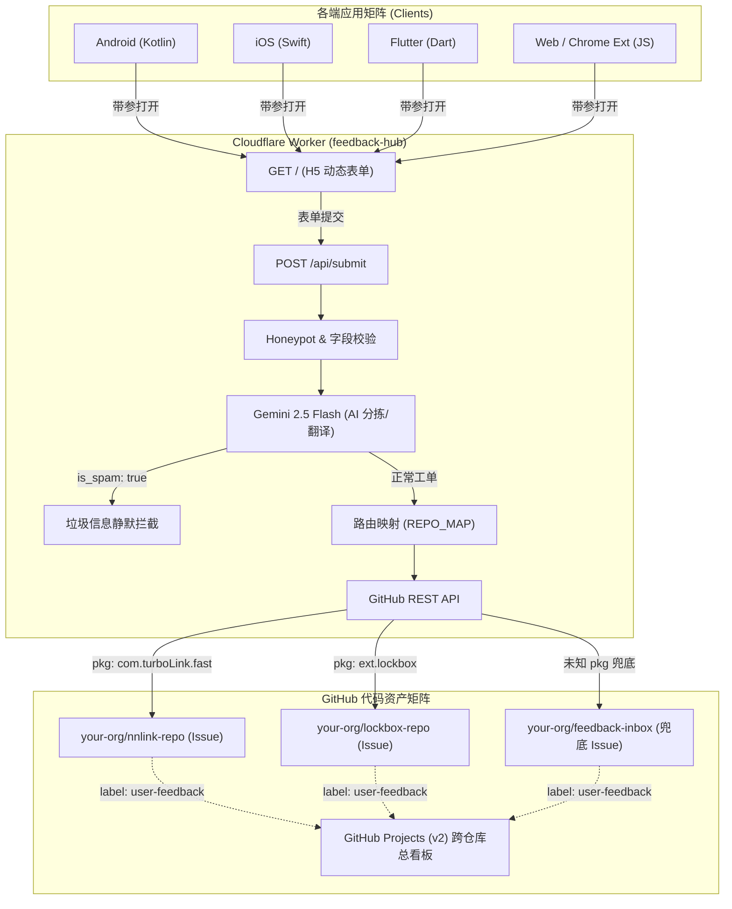

# 🚀 Feedback Hub (集中式工单反馈中心)

> **专为独立开发者多产品矩阵打造：零服务器成本、单向工单收集（免当客服）、AI 智能分拣与 GitHub 跨仓库敏捷聚合。**

---

## 💡 为什么需要 Feedback Hub？

作为独立开发者（Indie Hacker），你可能维护着多个独立的 iOS/Android App、Chrome 浏览器插件或 Web 网站，代码分散在 GitHub 的各个独立仓库中。传统做法存在以下痛点：
1. **客服沟通内耗**：许多用户反馈是情绪发泄、一句话乱码，或者需要来回拉扯询问设备型号与 App 版本，消耗大量宝贵编码时间；
2. **多端维护成本高**：每个 App 单独做一套反馈后端极不划算，买第三方客服 SaaS 又面临高昂的按人头/按月订阅费；
3. **语言障碍与分拣困难**：海外用户使用多种语言反馈，手动复制翻译繁琐低效；
4. **Issue 分散无法统揽**：频繁在多个 GitHub 仓库间来回切换查看反馈，容易遗漏高危崩溃 Bug。

**Feedback Hub** 彻底解决以上问题：
- **单 Worker 极简部署**：一个 Cloudflare Worker 同时承载静态自适应 H5 表单（GET `/`）与 API 路由（POST `/api/submit`），100% 运行在 Cloudflare 免费额度（每日 10 万次请求），**永久零服务器成本**；
- **去客服化心理预期管理**：界面与提交成功页温和引导：“团队专注改代码，所有工单直达排期看板，通常不提供人工一对一回复”，彻底免除客服包袱；
- **Gemini 2.5 Flash 智能分拣**：
  - 自动中文翻译与 15 字核心摘要（直接作为 Issue 标题）；
  - 智能评级严重程度（`high` / `medium` / `low`）；
  - 恶意谩骂、乱码及广告垃圾信息**静默拦截**，保持代码仓库纯净；
  - 5 秒超时保护与平滑降级，**绝不丢单**；
- **GitHub 跨仓库自动分发**：根据传入的 `pkg` 自动创建 Issue 到对应的独立项目仓库；未配置的新项目自动落入 `feedback-inbox` 兜底仓库；
- **跨平台一行代码接入**：提供 Android、iOS、Flutter、Web/Chrome Extension 开箱即用的客户端工具类。

---

## 🛠️ 技术架构



---

## 📁 目录结构

```text
feedback-hub/
├── clients/                  # 跨平台客户端接入代码 (Copy-Paste Ready)
│   ├── FeedbackHub.kt        # Android (Kotlin) 接入类 (App 内全屏 WebView 页面)
│   ├── FeedbackHub.swift     # iOS (Swift) 接入类 (App 内 WKWebView 页面)
│   ├── feedback_hub.dart     # Flutter 跨平台接入类 (App 内 WebView 页面)
│   └── feedback-hub.js       # Web 网站与 Chrome 浏览器扩展接入模块
├── docs/                     # 运维与接入配置指南
│   ├── DEPLOYMENT_GUIDE.md   # Cloudflare Worker 部署手册
│   └── GITHUB_SETUP_GUIDE.md # GitHub Fine-grained PAT 最小权限与跨仓库看板配置
├── src/
│   └── index.js              # Cloudflare Worker 核心代码 (包含 H5 渲染、Gemini 与 GitHub API)
├── test/
│   └── mock_test.js          # 本地全自动化集成与单元模拟测试套件
├── package.json              # 项目脚本与依赖
├── wrangler.toml             # Cloudflare Worker 部署配置文件
└── TEAM_BOARD.md             # 项目协作与任务看板
```

---

## ⚡ 快速上手

### 1. 克隆与安装依赖
```bash
git clone <your-repo> feedback-hub
cd feedback-hub
npm install
```

### 2. 配置密钥与环境变量
在终端中执行以下命令写入 Cloudflare Worker 密钥：
```bash
# 配置 Google Gemini API Key
npx wrangler secret put GEMINI_API_KEY

# 配置 GitHub Fine-grained Token (详见 docs/GITHUB_SETUP_GUIDE.md)
npx wrangler secret put GITHUB_TOKEN
```

在 `wrangler.toml` 中配置默认仓库与跨仓库映射：
```toml
[vars]
GITHUB_DEFAULT_REPO = "your-github-username/feedback-inbox"
REPO_MAP_JSON = '{"com.turboLink.fast": "your-github-username/nnlink-repo", "ext.lockbox": "your-github-username/lockbox-repo"}'
```

### 3. 本地测试与调试
```bash
# 运行单元与集成模拟测试 (8/8 全部通过)
npm run test

# 启动本地开发预览
npm run dev
```

在浏览器访问：
`http://localhost:8787/?pkg=com.turboLink.fast&ver=1.2.0&os=Android%2014&lang=zh`

### 4. 一键部署至 Cloudflare
```bash
npm run deploy
```

---

## 📱 客户端接入代码示例

移动端 SDK（Android / iOS / Flutter）均在 **App 内以原生 WebView 页面打开**反馈页，不会跳出 App 到浏览器；页面以 `embed=1` 模式加载，提交成功 / 点「完成」时通过 JS Bridge 回调原生。

所有客户端均**默认自动提取并上传设备当前真实系统语言**（无感支持全球 8 种主流语言自适应）与软硬件环境，并**支持 App 按产品需求自由深度自定义工单内容**（自定义分类列表、自定义主副标题、自定义占位符）：

### 1. Android (Kotlin)
复制 [clients/FeedbackHub.kt](file:///Volumes/T7%20Shield/MyDocument/customer/clients/FeedbackHub.kt) 至工程中（无需额外依赖，确保已声明 `INTERNET` 权限）：
```kotlin
// 极简调用（自动上传设备语言与系统信息）：
FeedbackHub.open(this)

// 深度自定义工单内容调用（根据自身 App 特点配置分类与标题）：
FeedbackHub.open(
    context = this,
    title = "FitFlow 健身反馈中心",
    desc = "动作库、周期记录与训练数据同步反馈",
    categories = listOf("数据同步失败", "动作库建议", "界面优化", "其他"),
    placeholder = "请描述您在做哪个动作或同步哪个设备时遇到的问题...",
    extraData = mapOf("plan" to "pro", "userId" to "usr_1002"),
    onSubmitted = { ticketId -> /* 提交成功 */ },
    onClose = { /* 页面关闭 */ }
)
```

### 2. iOS (Swift)
复制 [clients/FeedbackHub.swift](file:///Volumes/T7%20Shield/MyDocument/customer/clients/FeedbackHub.swift) 至工程中：
```swift
// 极简调用（App 内 WKWebView 页面弹出，支持下拉关闭）：
FeedbackHub.present(from: self)

// 深度自定义工单内容调用：
FeedbackHub.present(
    from: self,
    categories: ["视频黑屏", "滤镜卡顿", "字幕错位", "其他建议"],
    title: "剪辑大师用户反馈",
    desc: "遇到转码或播放异常请直接提交，工程师全力排查",
    placeholder: "请提供您的视频分辨率与复现步骤...",
    extraData: ["plan": "pro", "userId": "usr_998"],
    onSubmitted: { ticketId in /* 提交成功 */ },
    onClose: { /* 页面关闭 */ }
)
```

### 3. Flutter (Dart)
复制 [clients/feedback_hub.dart](file:///Volumes/T7%20Shield/MyDocument/customer/clients/feedback_hub.dart) 至工程中，并在 `pubspec.yaml` 添加 `webview_flutter: ^4.10.0`、`url_launcher: ^6.3.0`：
```dart
// 返回工单号；用户未提交直接关闭则为 null
final ticketId = await FeedbackHub.open(
  context,
  packageName: 'com.yourcompany.app',
  title: '视频剪辑反馈',
  categories: ['导出黑屏', '滤镜失效', '功能建议', '其他'],
  placeholder: '请提供视频分辨率与操作复现步骤...',
  extraData: {'plan': 'premium'},
);
```

### 4. Web / Chrome Extension (JavaScript)
复制 [clients/feedback-hub.js](file:///Volumes/T7%20Shield/MyDocument/customer/clients/feedback-hub.js) 至扩展工程中：
```javascript
FeedbackHub.open({
  pkg: "ext.lockbox",
  title: "LockBox 插件支持中心",
  categories: ["插件崩溃", "自动填充失效", "功能建议", "其他"],
  placeholder: "请描述目标网站网址与失效现象...",
  extra: { autoFillSuccess: false, targetDomain: "example.com" }
});
```

---

## 🛡️ 安全与防护设计

1. **Honeypot 蜜罐防爬虫**：
   表单内置不可见的 `website_url` 字段，爬虫自动填充后触发静默拦截，直接返回 200 假成功，不耗费 Gemini API 与 GitHub 配额；
2. **客户端 60 秒限流**：
   通过 `localStorage` 记录时间戳，提交后 60 秒内禁用提交按钮并呈现倒计时提示，防止重复点击与刷单；
3. **Gemini 垃圾内容拦截**：
   AI 判定 `is_spam === true`（无意义字符、纯骂人宣泄、商业广告）时，Worker 直接伪成功响应，不在 GitHub 产生 Issue；
4. **全链路容错降级**：
   Gemini API 设有 5 秒超时保护，发生超时或网络异常时自动使用用户原话截断兜底，**确保任何网络波动下用户反馈零丢失**；
5. **最小权限 Token**：
   GitHub Fine-grained PAT 仅授予所选仓库的 Issues 读写权限，无权读取或篡改源码，无信息外泄风险。

---

## 📄 开源许可
MIT License.
