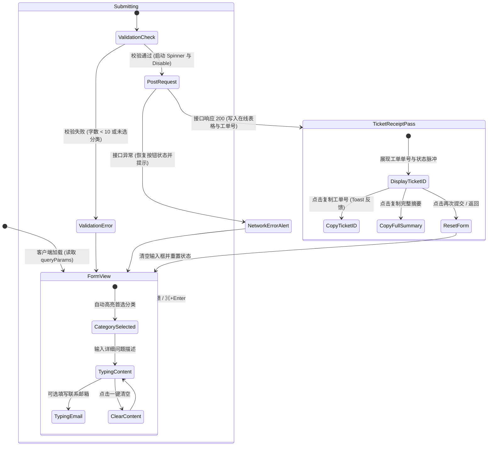

# Feedback Hub 2026 设计系统规范 (Design System Specification)

> **版本**：v2.0 (2026 Edition)  
> **设计语言**：Linear / Stripe 式极简高级微质感 + Apple HIG 原生弹窗规范  
> **适用场景**：独立客户端应用 Webview（iOS Safari / Android Custom Tabs）及桌面端自适应  
> **无障碍标准**：WCAG 2.1 AA 级（对比度 ≥ 4.5:1，可触达靶心 ≥ 44×44px）

---

## 1. 核心设计哲学 (Core Design Principles)

1. **形式服从功能 (Form Follows Function)**
   - 聚焦于“低心智负担的工单收集与确信感”，去除多余的装饰性色块，以精微质感（Subtle Textures）、呼吸焦点（Breathing Focus）与自然阴影（Soft Elevation）引导动线。
2. **原生触感与移动端优先 (Native Tactility)**
   - 移动端 Webview 具备顶部拉手（Sheet Handle）、原生回弹（Spring scale 0.98）、防 iOS 自动缩放（16px input font）以及 Safe Area 自动贴合。
3. **沉浸式深浅色双模 (Bimodal Contrast)**
   - 浅色模式保持清新空气感（`slate-50` 搭配纯白微悬浮面板）；
   - 深色模式采用黑曜石深邃质感（`slate-950` 底色搭配 `slate-900` 磨砂面板与微内发光，拒绝低端浑浊灰色）。
4. **确定性凭证感 (Physical Ticket Pass Experience)**
   - 提交成功不再是简单的绿色文字提示，而是重构为“数字工单凭据 / Ticket Receipt Pass”，具备撕裂虚线、票据两端内凹缺口（Ticket Notches）、等宽单号与一键复制反馈，大幅增强用户的被尊重感与信任感。

---

## 2. 颜色体系与设计 Token (Design Tokens)

### 2.1 主品牌色 (Brand Blue & Indigo)
| Token | Hex | 用途 |
| :--- | :--- | :--- |
| `--brand-50` | `#eff6ff` | 浅色选中背景、微徽章底色 |
| `--brand-100`| `#dbeafe` | 浅色输入框聚焦背景微光 |
| `--brand-500`| `#3b82f6` | 聚焦光环 (Focus Ring)、次级强调 |
| `--brand-600`| `#2563eb` | 主操作按钮起点色、品牌标识 |
| `--brand-700`| `#1d4ed8` | 主按钮悬浮态、深色强调 |
| `--indigo-600`| `#4f46e5` | 渐变主按钮终点色、凭证头部暗纹 |

### 2.2 中性基底色 (Surfaces & Neutral)
| 语义层级 | 浅色模式 (Light) | 深色模式 (Dark) | 用途 |
| :--- | :--- | :--- | :--- |
| **Canvas** | `#f8fafc` (slate-50) | `#020617` (slate-950) | 全局页面背景 |
| **Surface 1** | `#ffffff` (white) | `#0f172a` (slate-900) | 主卡片底色 (0.94 Alpha + Blur) |
| **Surface 2** | `#f1f5f9` (slate-100) | `#1e293b` (slate-800) | 输入框填充底色、未选中 Chip |
| **Border Subtle** | `rgba(226, 232, 240, 0.8)` | `rgba(51, 65, 85, 0.7)` | 卡片外框、分割线 |
| **Text Primary** | `#0f172a` (slate-900) | `#f8fafc` (slate-50) | 标题、核心工单编号 |
| **Text Secondary** | `#475569` (slate-600) | `#94a3b8` (slate-400) | 正文描述、字段 Label |
| **Text Muted** | `#94a3b8` (slate-400) | `#64748b` (slate-500) | 快捷键说明、占位符、字数统计 |

### 2.3 状态语义色 (Semantic States)
- **Success / Emerald**：`#10b981` (emerald-500) —— 脉冲在线指示、工单凭据对勾、复制成功提示；
- **Warning / Amber**：`#f59e0b` (amber-500) —— 去客服化预期管理卡片、字数接近上限提示；
- **Error / Rose**：`#f43f5e` (rose-500) —— 必填项缺失、字数超限、网络报错；
- **Ticket Pass**：`linear-gradient(135deg, #0f172a 0%, #1e1b4b 50%, #0f172a 100%)` —— 电子凭据头部质感。

---

## 3. 字体与排版阶梯 (Typography Scale)

| 阶梯 | 字体大小 | 字重 | 行高 | 追踪字距 | 适用元素 |
| :--- | :--- | :--- | :--- | :--- | :--- |
| **Display / Title** | 24px (1.5rem) / 28px (sm) | 800 (Boldest) | 1.25 | -0.025em | 页面主标题、产品名称 |
| **Receipt Code** | 18px (1.125rem) | 700 (Mono Bold) | 1.3 | +0.05em | 工单流水号 (Ticket ID) |
| **Section Header** | 12px (0.75rem) | 600 (Semibold) | 1.4 | +0.05em (Upper) | 表单分组 Label、辅助标注 |
| **Body Primary** | 14px (0.875rem) | 400 / 500 | 1.6 | -0.01em | 详细描述正文、输入框文本 |
| **Caption / Meta** | 12px (0.75rem) | 400 / 500 | 1.5 | 0 | 辅助提示、环境参数、字数状态 |

---

## 4. 核心交互状态设计 (Component States)

### 4.1 问题分类卡片 (Category Chip Grid)
- **Normal**：中性磨砂底，精致浅色边框，左侧带有 18x18 Lucide 精美矢量微图标；
- **Hover**：边框微发亮，背景提升至 `slate-100` 或 `slate-800`；
- **Active**：点击下压 `scale(0.97)`；
- **Selected**：外圈包裹微发光环 `ring-2 ring-brand-500/20`，图标与文字切换至品牌强调色，右侧浮现精美选中指示勾标。

### 4.2 详细描述框 (Textarea)
- **Breathing Glow**：聚焦时启动 `focus-within:ring-2 focus-within:ring-brand-500/25`；
- **Quick Clear**：输入文字后，顶部右侧浮现平滑淡入的“清空”按钮，单手一键重置；
- **Dynamic Progress Bar**：输入框底部嵌入 2px 极细线性进度条：
  - `< 10 字`：灰色/低饱和琥珀色，提示输入不足；
  - `10 ~ 900 字`：健康渐变绿/品牌蓝；
  - `> 900 字`：警示玫瑰红。

### 4.3 电子工单凭据 (Ticket Receipt Pass)
- 顶部集成沉浸式微渐变深黑/靛蓝横幅，带有呼吸脉冲指示灯；
- 左右两侧拥有 `-left-3` 与 `-right-3` 的真实半圆内凹打孔缺口（Ticket Notches）；
- 中间贯穿细致的虚线折线；
- 工单编号支持“一键复制”，带有“已复制”绿色对勾瞬间反馈；
- 支持“复制凭证摘要”，方便用户留底或转交技术团队。

---

## 5. 用户交互旅程与状态机 (State Machine)

